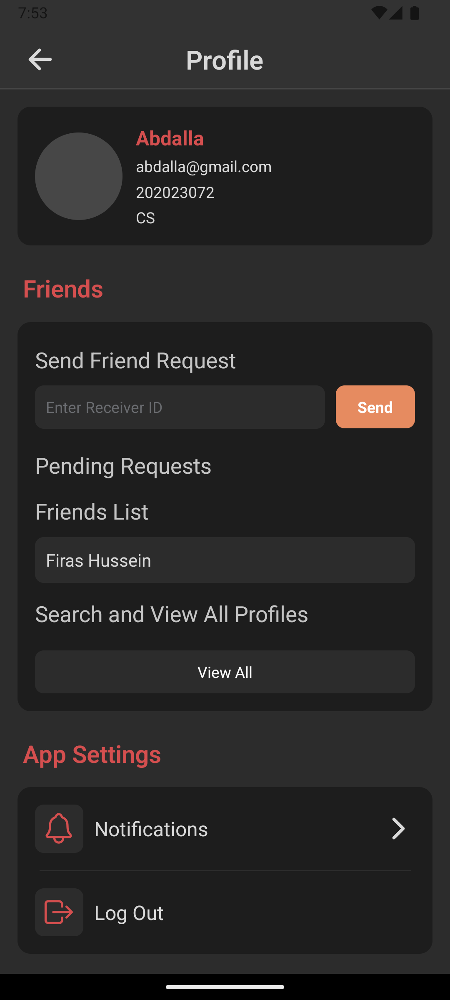

<div align="center">
  
  <br/>
  <table><tr><td width="560" align="center">
  A React Native app for campus event discovery and social coordination, replacing scattered group chats and bulletin boards with one structured platform.
  </td></tr></table>
</div>


## Overview

University students have no reliable way to know what's happening on campus. Events get announced across department boards, group chats, and club pages, and most students miss them.

Eventat gives students one place to browse, RSVP, and track events. You can see which friends are attending, follow club activity, and comment on events. The app is campus-scoped and uses real building coordinates, so location data is actually useful.


## Features

- **Event RSVP with attendance tracking**: join or leave events, see a live attendee count with profile picture previews
- **Event creation with multi-image upload**: up to 6 images uploaded to Firebase Storage; supports date/time picker, faculty location selection mapped to real coordinates, and room number
- **Personal calendar view**: joined and created events grouped by month
- **Time-based event filtering**: filter by Today, Tomorrow, This Weekend, or Upcoming without manual date entry
- **In-app event search**: live filtering by event name on the explore screen
- **Interactive campus map**: events plotted on Google Maps using building coordinates; tap a pin to open event details
- **Club directory**: browse clubs with member count, event count, and club-specific event feeds
- **Comments on events**: full CRUD comment system per event
- **Social friend system**: send, accept, and reject friend requests; view friend profiles
- **Secure token-based auth**: JWT stored in the OS-level secure enclave via `expo-secure-store`
- **Edit events**: creators can update details post-publish


## Technical Highlights

### State & Data Flow
- **Redux + Thunk**: Managed shared state across multiple domains, isolating async API logic and keeping UI components free of data-fetching concerns  
- **Axios interceptor**: Centralized JWT injection from `expo-secure-store` into all requests, removing auth handling from UI components  

### Security & Data Handling
- **Secure token storage**: Stored JWT and user data using `expo-secure-store`, leveraging OS-level encryption  
- **Firebase Storage uploads**: Implemented image upload flow with state managed outside Redux to avoid blocking UI  

### Architecture & Code Organization
- **Feature-based structure**: Organized components by feature (`Cards/`, `Headers/`, `ui/...`) rather than type for better maintainability  
- **Reusable utilities**: Extracted logic like `groupEventsByMonth` into standalone helpers  

### UX & Product Decisions
- **Structured location input**: Mapped campus buildings to fixed GPS coordinates, ensuring accurate map pins  
- **Responsive layout**: Used `useWindowDimensions()` with breakpoints to adapt across device sizes

## Architecture

The app is organized around feature ownership and separation of concerns:

- `API/action/`: Redux thunks and Axios API calls, grouped by domain
- `API/reducers/`: domain reducers for auth, events, clubs, comments, and friends
- `screens/`: full app screens such as Explore, Calendar, Create, Map, and Profile
- `components/`: reusable UI grouped by feature, such as cards, headers, auth UI, and profile UI
- `navigators/`: stack and tab navigation configuration
- `utils/`: shared helpers such as event grouping by month

Auth state determines which navigation stack mounts at the root. API calls are isolated from screen components, keeping UI code focused on rendering and interaction.


## Screenshots

<div align="center">
  <table>
    <tr>
      <td align="center"><br/><sub>Explore</sub></td>
      <td align="center"><br/><sub>Event Details</sub></td>
      <td align="center"><br/><sub>Comments</sub></td>
    </tr>
    <tr>
      <td align="center"><br/><sub>My Events</sub></td>
      <td align="center"><br/><sub>Attending (Empty)</sub></td>
      <td align="center"><br/><sub>Club List</sub></td>
    </tr>
    <tr>
      <td align="center"><br/><sub>Club Details</sub></td>
      <td align="center"><br/><sub>Settings</sub></td>
      <td></td>
    </tr>
  </table>
  <p><sub>More screenshots available in the <a href="./docs">docs/</a> folder.</sub></p>
</div>


## Tech Stack

| Layer | Technology |
|---|---|
| Framework | React Native (Expo SDK 53) |
| Language | JavaScript (React 19) |
| State Management | Redux + Redux Thunk |
| Server State | TanStack React Query (v5) |
| Navigation | React Navigation v7 (Native Stack + Bottom Tabs) |
| HTTP Client | Axios with request interceptor |
| Auth Storage | expo-secure-store (hardware-backed) |
| Image Storage | Firebase Storage |
| Maps | react-native-maps (Google Maps) |
| Date Handling | Moment.js + @react-native-community/datetimepicker |
| Backend | NestJS REST API, deployed on Vercel |


## Setup & Installation

Built on Expo SDK 53. The current Expo Go app no longer supports SDK 53, so run it on an Android emulator (`npx expo start`, then press `a`) or install the SDK 53 build of Expo Go from [expo.dev/go](https://expo.dev/go).

```bash
git clone https://github.com/brullee/Eventat.git
cd Eventat
npm install
npx expo start
```

Copy `firebaseConfig.example.js` to `firebaseConfig.js` and fill in your Firebase credentials. The Google Maps API key goes in `app.json` under `android.config.googleMaps.apiKey`.

## My Role

I conceived and led the project, designed the app, and built the frontend screens and UI.

### Product & Design
- Came up with the idea and drove product decisions from concept to a finished, presentation-ready build
- Designed the app in Figma: user flows, wireframes, and high-fidelity mockups
- Kept a consistent dark theme using shared color constants

### Frontend Screens & UI
- **Screens**: Explore, Calendar, Create, Edit Event, Event Details, Club List, Club Details, Club Events, Profile and friends, and the auth screens
- **Event cards & attendee tracking**: event cards with a live attendee count and profile picture previews
- **Slide-to-join**: a custom slide gesture for joining an event, modeled on the iOS lock-screen call answer
- **Event creation screen**: multi-image upload (up to 6 images), date/time selection, and coordinate-mapped location input
- **Image viewer**: paginated image slider plus a full-screen zoom and slide-through modal for event and profile images
- **Calendar & filtering**: grouped-by-month calendar (including the `groupEventsByMonth` helper) and time-based filters (Today/Tomorrow/Weekend/Upcoming)
- **Comments**: comment section UI with timestamps and profile pictures
- **Auth screens**: login/signup UI and input handling (the auth logic was built by my teammate)
- **Navigation**: bottom tab navigator with custom icons and styling, plus the main screen stack and app theme

## Notes

Built as a graduation project. [Firas Hani](https://github.com/FirasHani) developed the NestJS REST API ([backend repository](https://github.com/FirasHani/eventat-app-backend)) and also built the map integration and login/auth logic on the frontend. Firas also wrote the Redux state layer (store, reducers, thunks), the Axios API layer with its auth interceptor, and the auth-based switch between the login and main navigation stacks. [Zena Nusair](https://github.com/ZenaNusair) contributed to the frontend early in the project.

Selected for presentation at [NTP 2025](https://www.linkedin.com/in/abdalla-wohoush/overlay/Certifications/1965221544/treasury?profileId=ACoAAA_8wJcBnBHU-kOsS35VkzfnzjahMadEobY) and awarded [2nd place](https://www.linkedin.com/in/abdalla-wohoush/overlay/Honor/2080759075/treasury/?profileId=ACoAAA_8wJcBnBHU-kOsS35VkzfnzjahMadEobY) in the university’s graduation project competition.

The app was completed as a presentation-ready build and was not released publicly. The frontend was integrated and tested against the deployed backend during development.
